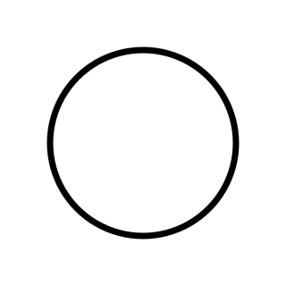

# Logo di Materia Oscura

Versione v3 · 18 ottobre 2026. Creato su richiesta esplicita dell’utente a partire dalla configurazione della stringa chiusa al centro in basso dell’immagine di riferimento. Posizione nella home scelta dall’utente: **accanto al titolo**. I file restano autonomi e riutilizzabili.

- **logo-materia-oscura.svg**: originale vettoriale animato, nero su fondo trasparente; nessun JavaScript o risorsa esterna.
- **logo-materia-oscura.gif**: esportazione animata trasparente, 256 × 256 px, 20 fotogrammi al secondo, 160 fotogrammi, ciclo di 8 secondi.
- **logo-materia-oscura-statico.svg**: versione fissa con quattro lobi orizzontali e verticali, per stampe o contesti senza animazione.

Il ciclo mostra una sola curva continua e chiusa: **cerchio → quattro lobi orizzontali e verticali → cerchio → quattro lobi diagonali → cerchio**. Non sovrapporre le configurazioni, aggiungere scie, sfumature o riempimenti. Nessun rettangolo di sfondo fa parte del logo. Il motivo a quadretti dell’anteprima serve soltanto a mostrare la trasparenza.

Lo SVG usa `viewBox="0 0 320 320"`, tratto nero di 7 unità, raccordi arrotondati e un ciclo dichiarativo SVG di 8 secondi. La deformazione è costruita con una curva polare a quattro lobi: il cambio di segno dell’ampiezza alterna le due orientazioni passando dal cerchio. Non è una misura sperimentale né una simulazione fisica quantitativa. In ogni momento è visibile una sola configurazione; con la preferenza di movimento ridotto lo SVG mostra un cerchio fermo.

Per inserirlo in un’altra pagina basta, per esempio:

```html

```

Usare lo SVG quando possibile per mantenere il logo nitido a qualsiasi dimensione. La GIF offre una copia per le applicazioni che accettano animazioni raster. La home incorpora direttamente lo stesso SVG attraverso `scripts/home_italian.py`, così non dipende da una richiesta esterna e consente pausa/ripresa premendo il logo o usando la tastiera. Il tasto è attivato solo quando gli script sono disponibili; l’animazione SVG funziona anche senza di essi.

Il sorgente geometrico riproducibile è `scripts/logo_materia_oscura.py`: `python scripts/logo_materia_oscura.py` rigenera i due SVG. Se cambia il disegno, riesportare anche la GIF dallo SVG corrente e aggiornare il registro di verifica. La build incorpora il file animato corrente; le modifiche a `identita/` attivano il workflow Pages soltanto quando integrate in `main`.

Riferimento originale conservato senza modifiche in `lavorazione/sito/risorse-originali/riferimento-stringhe.jpg`; non fa parte del sito pubblico. Controlli e dimensioni effettive in `lavorazione/sito/verifica-logo.json`. Anteprima autonoma in `lavorazione/sito/anteprima-logo.html`.

## Proposta progressiva, superata dalla correzione successiva

L’utente ha corretto l’idea iniziale: la nuova GIF rappresenta **una sinusoide che viaggia lungo una curva chiusa**, con quattro creste, senza alternanza fra cerchio e forme a lobi. La deformazione è contenuta e ha ampiezza costante. Le creste avanzano in senso orario.

File autonomi: **logo-materia-oscura-onda-progressiva.svg** e **logo-materia-oscura-onda-progressiva.gif**. La GIF è trasparente, 256 × 256 px, 80 fotogrammi a 20 fps, ciclo di 4 secondi. Il tratto resta nero; lo SVG non richiede script e rispetta la preferenza di movimento ridotto.

Il profilo è `r(θ,t) = 104 + 10 cos(4θ − 2πt/T)`, con `T = 4 s`. Le quattro creste si spostano conservando ampiezza e forma: non è un’oscillazione stazionaria. Per questa armonica circolare la propagazione di fase equivale esattamente alla rotazione del profilo di 90° in un periodo; il ciclo ricomincia senza salti perché la forma è periodica ogni 90°. Il riferimento circolare resta fisso e non è disegnato come seconda linea.

Generatore: `python scripts/logo_onda_progressiva.py`. Anteprima: `lavorazione/sito/anteprima-logo-onda-progressiva.html`; verifiche: `lavorazione/sito/verifica-logo-onda-progressiva.json`. La home conserva temporaneamente il logo precedente: questa richiesta riguarda la nuova GIF autonoma. La variante a otto lobi interrotta è superata e conservata come lavoro locale in `/workspace/varianti-logo-superate/otto-lobi/`, fuori dal repository e dalla pubblicazione.

## Versione corrente: onda sinusoidale stazionaria

L’ultima correzione dell’utente richiede un’**onda stazionaria**, mantenendo quattro creste. La configurazione non ruota: i nodi angolari restano fermi e i ventri oscillano radialmente. Il profilo passa per il cerchio e inverte la deformazione.

File autonomi correnti: **logo-materia-oscura-onda-stazionaria.gif** e **logo-materia-oscura-onda-stazionaria.svg**. Restano nero su trasparente, tratto di 7 unità, GIF 256 × 256 px a 20 fps, 80 fotogrammi e periodo di 4 secondi. La nuova variante conserva la deformazione contenuta della proposta precedente.

Modello: `r(θ,t) = 104 + 10 cos(4θ) sin(2πt/T)`, con `T = 4 s`. I nodi sono fissi a `θ = 22,5° + k · 45°`; i ventri hanno segno opposto nei due semiperiodi. Il fattore temporale sinusoidale è campionato in 32 intervalli nello SVG, con interpolazione lineare: errore massimo sullo spostamento inferiore a 0,05 unità del viewBox. Non viene applicata alcuna rotazione. Con movimento ridotto si mostra un cerchio fermo.

Rigenerare con `python scripts/logo_onda_stazionaria.py`. La geometria di base è condivisa con il generatore precedente, la cui uscita predefinita resta invariata. Anteprima: `lavorazione/sito/anteprima-logo-onda-stazionaria.html`; verifiche: `lavorazione/sito/verifica-logo-onda-stazionaria.json`. Le proposte precedenti rimangono recuperabili; la home non è modificata automaticamente da questa correzione della GIF.
