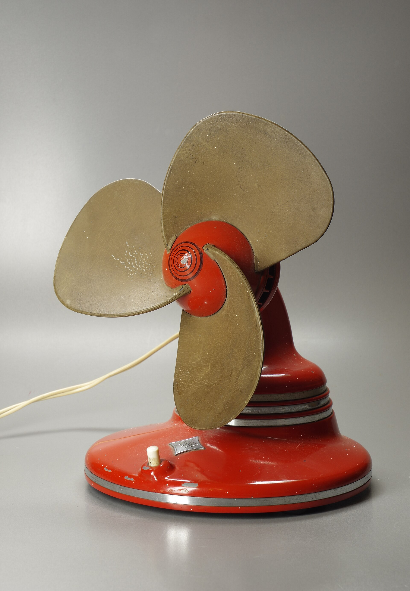
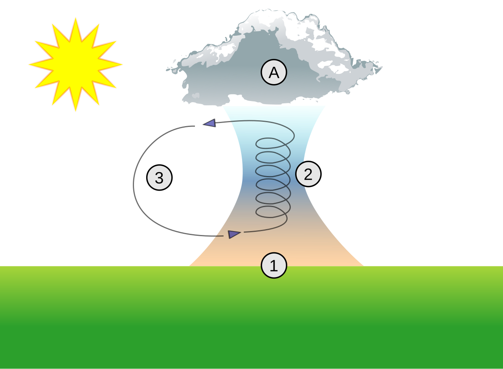
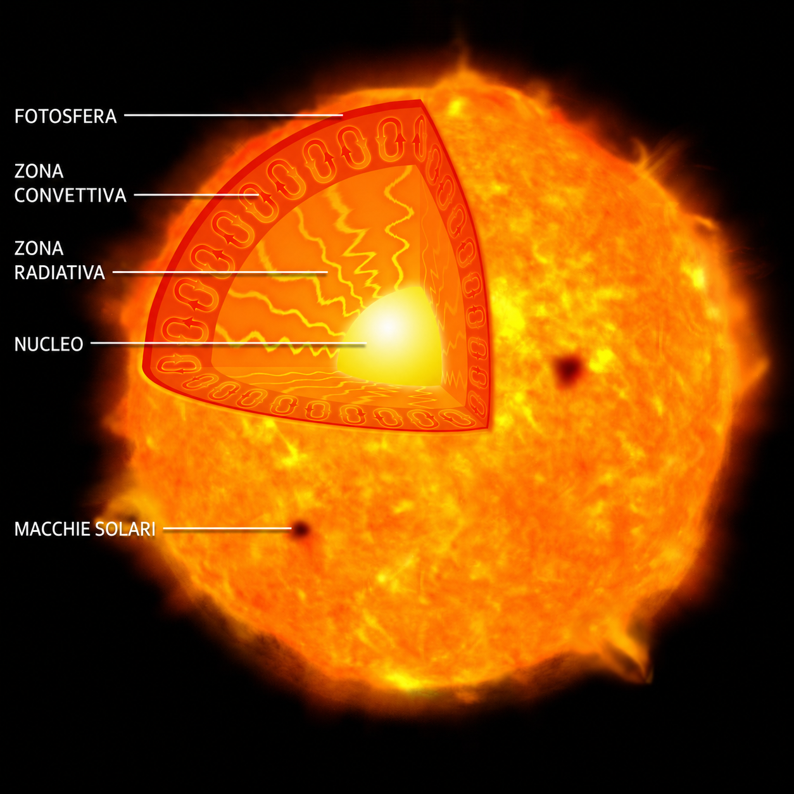
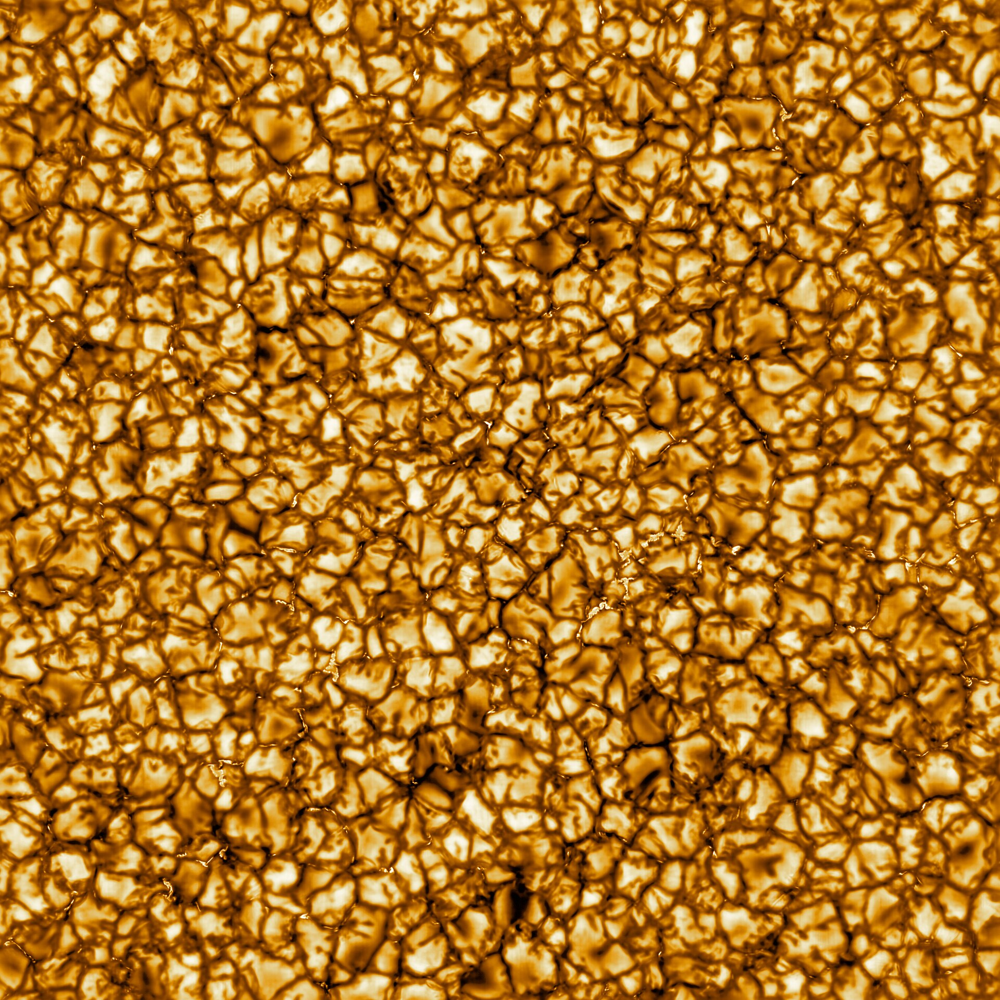

# Convezione

[COPERTINA V-C — Nuova scelta esplicita dell’utente: Sputnik Planitia su Plutone, New Horizons. File: risorse/copertina-plutone.jpg, versione 1920 px fornita, senza modifiche. Fonte e credito NASA/JHUAPL/SwRI nel registro. Sostituisce Convection-cells.jpg; non ripetere nel corpo.]

Didascalia di copertina: Le strutture poligonali di Sputnik Planitia, su Plutone, sono associate a lenti moti convettivi nel ghiaccio di azoto.[6]

## L’aria sopra il termosifone

Un termosifone occupa una piccola parte della parete, eppure contribuisce a riscaldare l’aria di tutta la stanza. Quella che lo tocca si scalda per prima, ma non rimane ferma accanto alla sua superficie. Si sposta e viene sostituita da altra aria. Che cosa mette in moto questa circolazione?

[IMMAGINE 14 — Radiator-convection.svg, schema originale scelto; risorse/termosifone-convezione.svg.]

Didascalia: L’aria riscaldata dal termosifone sale e si sposta nella stanza; raffreddandosi, ridiscende lontano dalla sorgente e torna verso il termosifone.

Riscaldandosi, l’aria vicina al termosifone tende a espandersi: la stessa massa occupa un volume maggiore e la sua **densità diminuisce**. Rispetto all’aria circostante più densa, riceve una spinta verso l’alto che può farla salire. Altrove, l’aria relativamente più fredda e densa può scendere e prendere il suo posto. Si forma così un movimento che trasporta energia da una zona all’altra.[1]

Questo trasferimento di energia, legato al movimento di un fluido, si chiama **convezione**. Un fluido può essere un liquido oppure un gas, come l’aria. A muoversi è la materia, che porta con sé energia interna: nel caso della stanza, l’aria riscaldata si allontana dal termosifone e contribuisce a distribuire energia nell’ambiente.

## Convezione naturale e forzata

Nella stanza il movimento nasce dalle differenze di densità e dall’azione della gravità. Si parla di **convezione naturale**. La spinta di Archimede agisce anche nei gas: una porzione di fluido meno densa di ciò che la circonda può salire, mentre una più densa tende a scendere. Per questo «l’aria calda sale» è una descrizione abbreviata di un fenomeno che dipende dal confronto con l’aria circostante.

Il fluido può però essere messo in movimento anche da un dispositivo. Una ventola spinge l’aria, una pompa fa circolare un liquido: in questi casi si parla di **convezione forzata**. Il movimento rinnova il fluido vicino alle superfici e può rendere più rapido lo scambio di energia. La differenza tra i due casi riguarda dunque soprattutto ciò che produce il movimento.

[IMMAGINE V-F — Ventilatore da tavolo fornito dall’utente; Berthold Werner, CC BY-SA 4.0. File: risorse/ventilatore-forzata.jpg, versione 1920 px invariata. Foto riservata all’introduzione della convezione forzata; la ventola del processore compare soltanto nella relativa applicazione.]

Didascalia: Quando ruotano, le pale del ventilatore mettono in movimento l’aria: il moto è prodotto da un dispositivo, come avviene nella convezione forzata.

Il ricambio del fluido non determina da solo il verso del trasferimento. Se una superficie è più calda dell’aria che la raggiunge, cede energia all’aria; se l’aria è più calda, può invece riscaldarla. Muovere l’aria non significa abbassarne automaticamente la temperatura: è un punto essenziale per capire che cosa fanno le ventole nei sistemi di raffreddamento.[2]

## Applicazioni

### Gli uccelli salgono senza battere le ali

Un rapace può descrivere ampi cerchi nel cielo e guadagnare quota tenendo le ali distese. Come riesce a salire senza batterle? In queste situazioni può sfruttare una corrente d’aria ascendente chiamata **termica**. È un comportamento comune a molti uccelli veleggiatori, tra cui aquile, poiane, avvoltoi e cicogne.

Il Sole riscalda il terreno, che a sua volta trasferisce energia all’aria vicina alla superficie. Dove il riscaldamento è maggiore, l’aria può diventare meno densa di quella circostante e salire per effetto della spinta di Archimede. Si forma così una regione di aria ascendente: è un esempio di convezione naturale, perché il movimento nasce dalle differenze di densità e dall’azione della gravità.

[IMMAGINE N-1 — Scelta esplicita dell’utente: poiana codarossa in una termica, NPS/Jacob W. Frank, pubblico dominio. File a 1920 px fornito: risorse/poiana-termica.jpg. Nessun ritaglio o elaborazione.]

[SCHEMA N-2 — Immagine Thermal column.svg, scelta e fornita dall’utente; Dake, CC BY 2.5. Copia PNG a 1280 px invariata: risorse/termica-numerata.png; originale vettoriale conservato: risorse/termica-numerata-originale.svg. Nessuna traduzione o ricostruzione necessaria.]

Didascalia: **(1)** Il terreno riscaldato dal Sole cede energia all’aria vicina alla superficie. **(2)** L’aria riscaldata, meno densa di quella circostante, risale nella termica. **(3)** I moti discendenti attorno alla zona ascendente contribuiscono al ricircolo dell’aria. **(A)** In cima può formarsi una nube, se l’aria umida si raffredda abbastanza da far condensare il vapore acqueo.

Didascalia: Una poiana codarossa sfrutta una termica. Molti uccelli veleggiatori usano l’aria ascendente per guadagnare quota.

Volando in cerchio, l’uccello può rimanere all’interno della termica. Durante il volo planato tende a scendere rispetto all’aria che lo sostiene, ma se quell’aria sale abbastanza rapidamente, l’animale guadagna quota rispetto al terreno. Il moto convettivo dell’aria rende quindi possibile una risalita che, osservando soltanto le ali ferme, potrebbe sembrare difficile da spiegare.[3]

### Le celle convettive del Sole

Osservata ad alta risoluzione, la superficie visibile del Sole, chiamata **fotosfera**, appare come un mosaico di zone luminose separate da bordi più scuri. Queste strutture si chiamano **granuli**: che cosa rivelano del movimento della materia solare?

Negli strati esterni dell’interno solare, l’energia viene trasportata anche dalla convezione. Il materiale è **plasma**, un gas almeno in parte ionizzato, che contiene particelle cariche. Le porzioni più calde e meno dense rispetto a ciò che le circonda possono risalire verso la superficie, trasportando energia. Qui il plasma cede energia, si raffredda e ridiscende, contribuendo a formare le **celle convettive**.[5]

[SCHEMA S-1A — Illustrazione NASA/CXC/M.Weiss di una stella simile al Sole, scelta dall’utente. Etichette tradotte in italiano su richiesta: Fotosfera, Zona convettiva, Zona radiativa, Nucleo, Macchie solari. Versione italiana: risorse/sole-schema-it.png. Conservare risorse/sole-schema-originale.jpg e provenienza TIFF nel registro.]

Didascalia: Nella zona convettiva il plasma trasporta energia attraverso moti di risalita e discesa. Lo schema distingue questa regione dagli strati più interni e dalla fotosfera.

Lo schema permette di collocare il movimento all’interno della stella; la fotografia seguente ne mostra una traccia osservabile sulla fotosfera. I granuli luminosi corrispondono alle regioni dove risale materiale più caldo, mentre lungo i bordi scuri il plasma raffreddato ridiscende. Il Sole non ha una superficie solida come quella terrestre e queste strutture non sono bolle di ebollizione.

[IMMAGINE S-1B — Fotografia della granulazione solare ottenuta con il Daniel K. Inouye Solar Telescope, NSO/AURA/NSF, CC BY 4.0. Versione a 1920 px scelta dall’utente, senza modifiche: risorse/sole-granulazione.jpg. Crediti nella sezione finale, non nella didascalia.]

Didascalia: La fotosfera presenta un mosaico di granuli luminosi e bordi più scuri, legato ai moti convettivi del plasma.

Anche in questo ambiente molto diverso da una stanza, il movimento della materia contribuisce al trasporto di energia. L’illustrazione e la fotografia raccontano due aspetti dello stesso fenomeno: dove avviene e quali strutture produce nella regione osservabile.

### La ventola del processore

Un processore in funzione trasforma parte dell’energia elettrica in energia interna e si riscalda. Il dissipatore riceve energia dal processore e la conduce attraverso il metallo fino alle alette. Queste offrono un’ampia superficie a contatto con l’aria: molte lamine sottili permettono di aumentarla senza usare un blocco metallico massiccio.

[IMMAGINE 17 — Fotografia del dissipatore con ventola, scelta dall’utente; risorse/processore-ventola.jpg.]

Didascalia: Sotto la ventola si distinguono le alette metalliche del dissipatore. La ventola rinnova l’aria a contatto con queste superfici.

La ventola spinge tra le alette aria relativamente più fresca, sostituendo quella già riscaldata. L’aria riceve energia dalle superfici e la porta lontano: è la parte del percorso in cui interviene la convezione forzata. Il funzionamento richiede quindi sia un buon contatto termico tra processore e dissipatore, sia una circolazione d’aria sufficiente. Aumentare soltanto la ventilazione non risolve un cattivo contatto con il processore.

### Il radiatore dell’automobile

Anche un motore a combustione deve cedere energia per evitare un riscaldamento eccessivo. Una pompa fa circolare il liquido refrigerante nel motore, dove riceve energia, e poi nel radiatore. Qui il liquido attraversa tubi metallici collegati a numerose alette: l’energia passa alle pareti e viene ceduta all’aria che attraversa il radiatore.

[IMMAGINE 18 — Fotografia delle due ventole dietro il radiatore, scelta dall’utente; risorse/radiatore-ventole.jpg.]

Didascalia: Le due ventole installate dietro il radiatore favoriscono il passaggio dell’aria e lo scambio di energia con l’ambiente.

Il movimento dell’automobile favorisce il passaggio dell’aria, mentre la ventola può mantenerlo o aumentarlo quando l’auto è ferma o procede lentamente. Le alette estendono la superficie di scambio, come nel dissipatore del processore.

In entrambi i dispositivi conduzione e convezione svolgono compiti collegati. Il metallo trasferisce energia attraverso le parti solide; il fluido in movimento la porta verso altre regioni. È questo percorso a rendere utili insieme materiali conduttori, superfici alettate, pompe e ventole.[4]

## Domande di verifica

1. **Il termosifone.** Perché l’aria sopra un termosifone tende a salire? In quali punti della stanza l’aria più fredda può scendere? Spiega il ruolo delle differenze di densità.

2. **Gli uccelli nella termica.** Come si forma una termica sopra un terreno riscaldato dal Sole? Perché molti uccelli veleggiatori possono guadagnare quota senza battere le ali? Spiega quale ruolo hanno densità dell’aria, gravità e movimento dell’aria.

3. **I granuli del Sole.** Quali parti della granulazione corrispondono al plasma che risale e quali al materiale che ridiscende? In che modo questo movimento trasporta energia?

4. **Naturale o forzata?** Distingui la convezione naturale vicino al termosifone e nelle termiche sfruttate dagli uccelli dalla convezione forzata nei sistemi con ventola. Che cosa mette principalmente in movimento il fluido nei due casi?

5. **Radiatore dell’auto e processore.** Spiega perché il radiatore e il dissipatore CPU hanno numerose alette. Quali parti svolgono il trasferimento per conduzione e quali permettono la convezione forzata?

6. **Il ventilatore e la temperatura del corpo.** Durante una giornata molto calda, una persona utilizza un ventilatore, che muove l’aria ma non ne abbassa direttamente la temperatura. Perché può favorire il raffreddamento quando l’aria è più fresca della pelle? Che cosa cambia nel trasferimento per convezione se l’aria diventa più calda della pelle? Perché il ventilatore può ancora aiutare se il sudore evapora efficacemente? In quali condizioni di temperatura e umidità può invece diventare insufficiente o contribuire al surriscaldamento? Motiva le risposte.

7. **Assenza di gravità.** In condizioni di assenza di gravità, si formerebbero le stesse correnti naturali osservate in una stanza sulla Terra? Una ventola potrebbe invece continuare a muovere l’aria? Spiega.

## Note

[1] Finestre, arredi e pareti modificano il percorso reale dell’aria: le frecce rappresentano un modello semplificato. Il termosifone trasferisce energia alla stanza anche per irraggiamento.

[2] Sulla pelle sudata interviene anche l’evaporazione: il passaggio del sudore allo stato di vapore sottrae energia alla pelle. L’aria in movimento può favorirlo, ma un’umidità elevata lo ostacola; in condizioni molto calde e umide questo effetto può risultare insufficiente a compensare il calore ricevuto.

[3] Le termiche sono uno dei meccanismi che permettono il volo veleggiato: esistono anche correnti ascendenti prodotte dal vento che incontra un rilievo. Qui consideriamo soltanto la risalita dovuta al riscaldamento del terreno. La nube del diagramma non accompagna tutte le termiche: può formarsi per condensazione del vapore acqueo nell’aria che risale e si raffredda. Fonti: [Cornell Lab, Golden Eagle Soaring on a Thermal](https://academy.allaboutbirds.org/golden-eagle-soaring-on-a-thermal/) e [NASA, Forces on a Glider](https://www.grc.nasa.gov/www/k-12/VirtualAero/BottleRocket/airplane/glider.html).

[4] Negli scambi dei dispositivi reali può contribuire anche l’irraggiamento.

[5] La convezione descritta riguarda la zona convettiva sotto la superficie visibile, non tutti gli strati solari. Fonti scientifiche: [NASA, Photospheric Features](https://solarscience.msfc.nasa.gov/feature1.shtml) e [NASA, Heliophysics Big Idea 3.2](https://science.nasa.gov/learn/heat/big-ideas/big-idea-3-2/). La fotografia della granulazione è acquisita nel vicino infrarosso e presentata in colori rappresentativi: non mostra l’aspetto del Sole a occhio nudo.

[6] In questo caso il ghiaccio di azoto rimane solido, ma può deformarsi e scorrere molto lentamente su tempi geologici. Fonte: [NASA, Pluto’s Heart: Like a Cosmic ‘Lava Lamp’](https://www.nasa.gov/solar-system/plutos-heart-like-a-cosmic-lava-lamp/). Questo caso estende la descrizione introduttiva dei liquidi e gas a un materiale che scorre su tempi molto lunghi.
