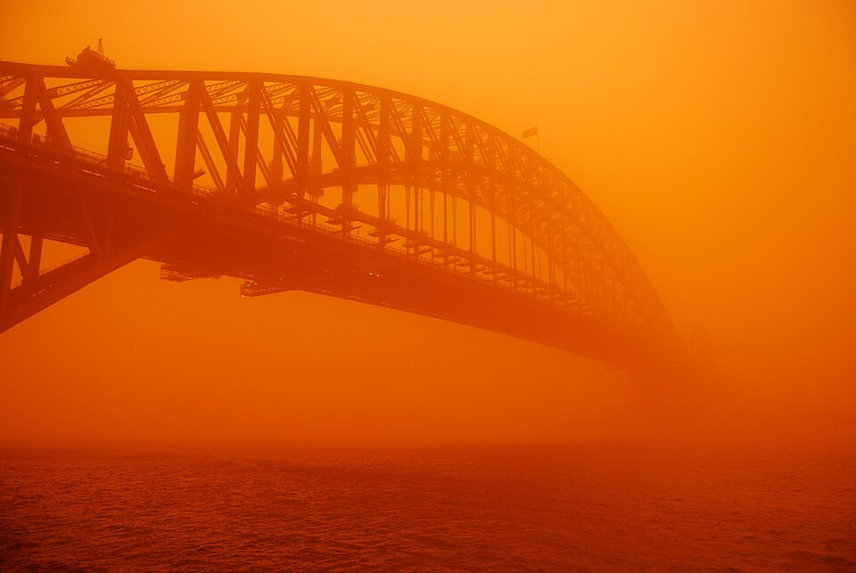
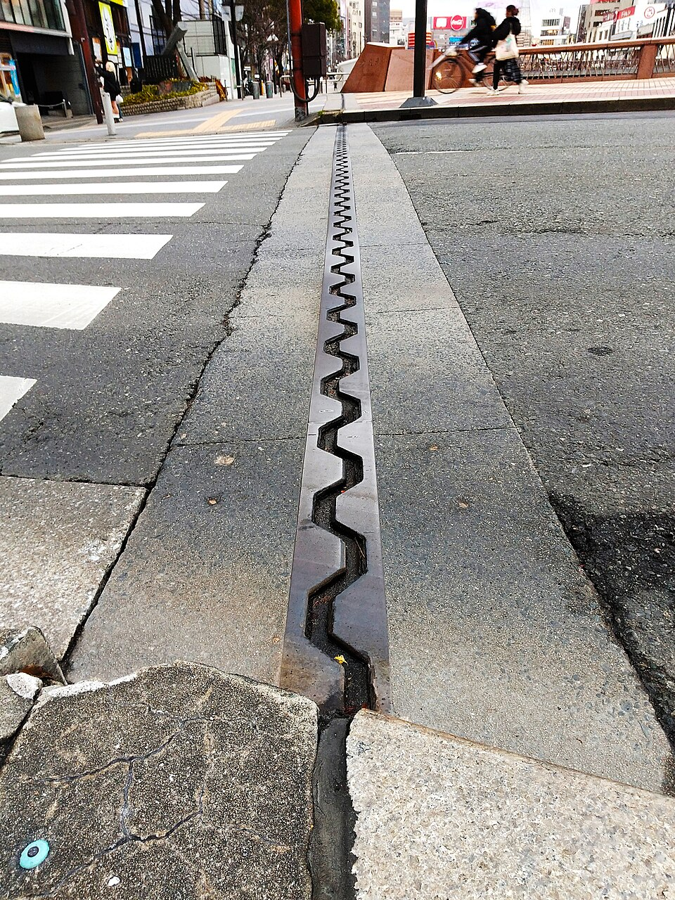
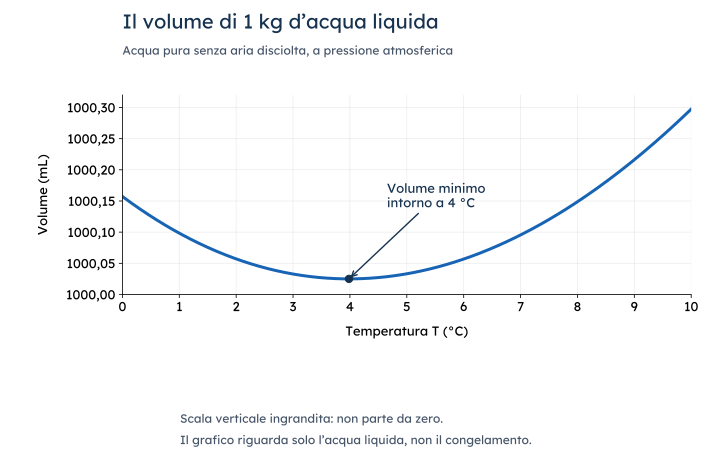
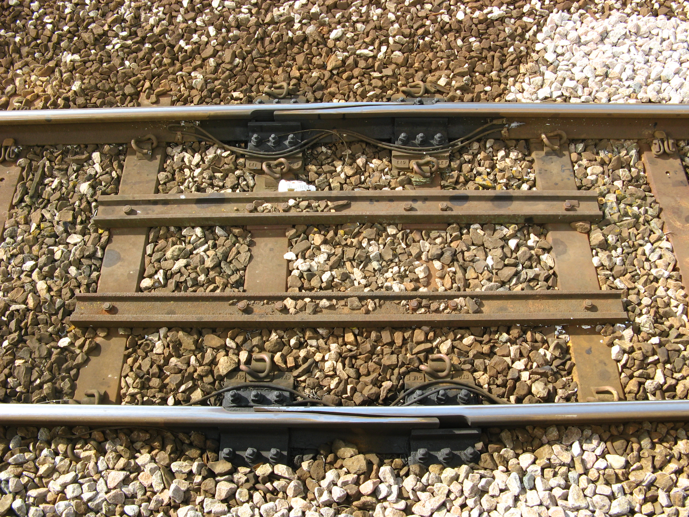
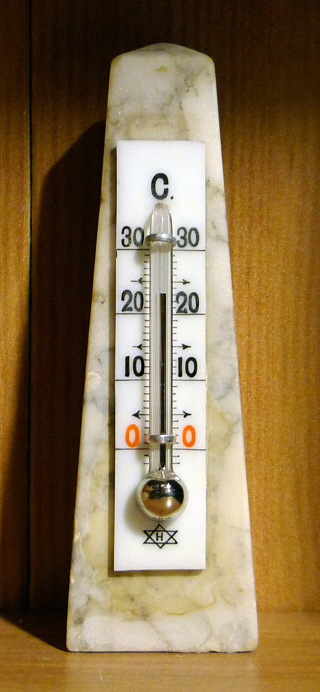
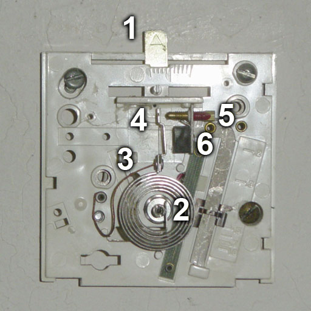
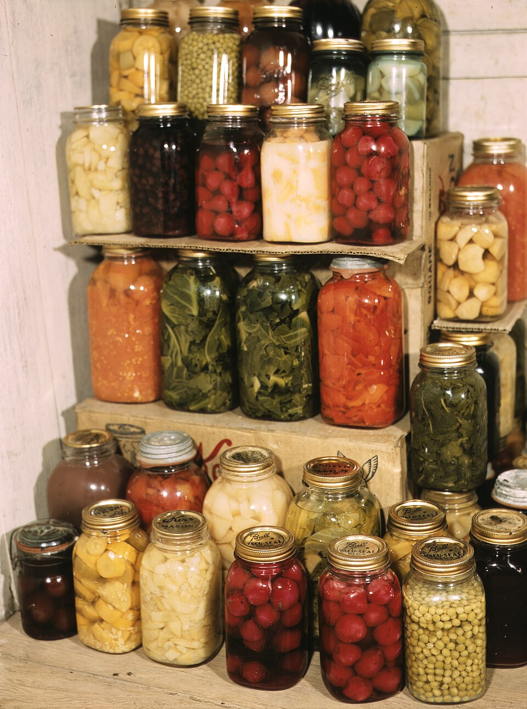
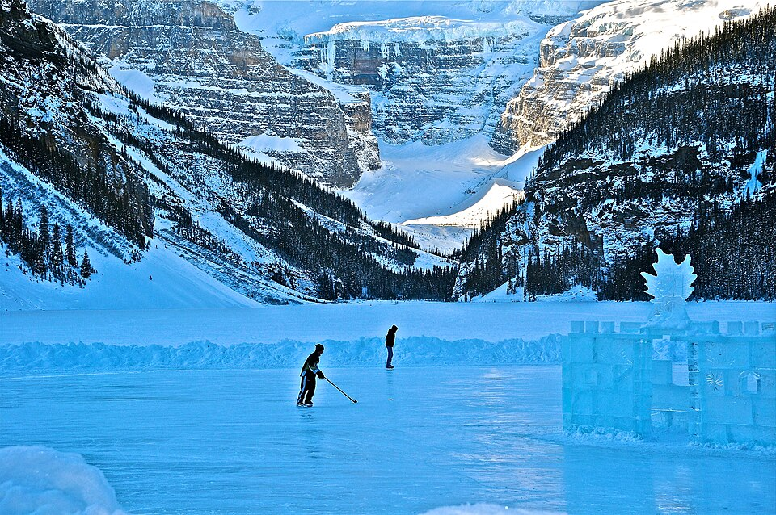
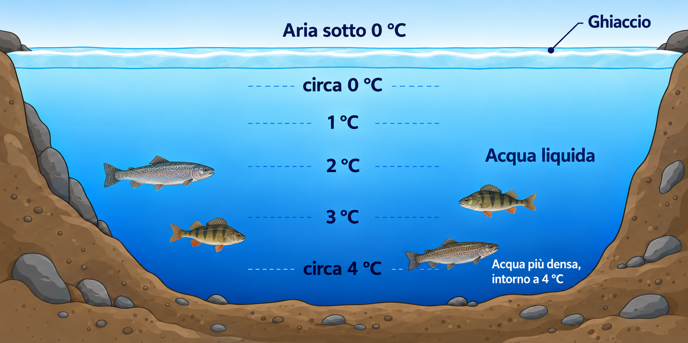
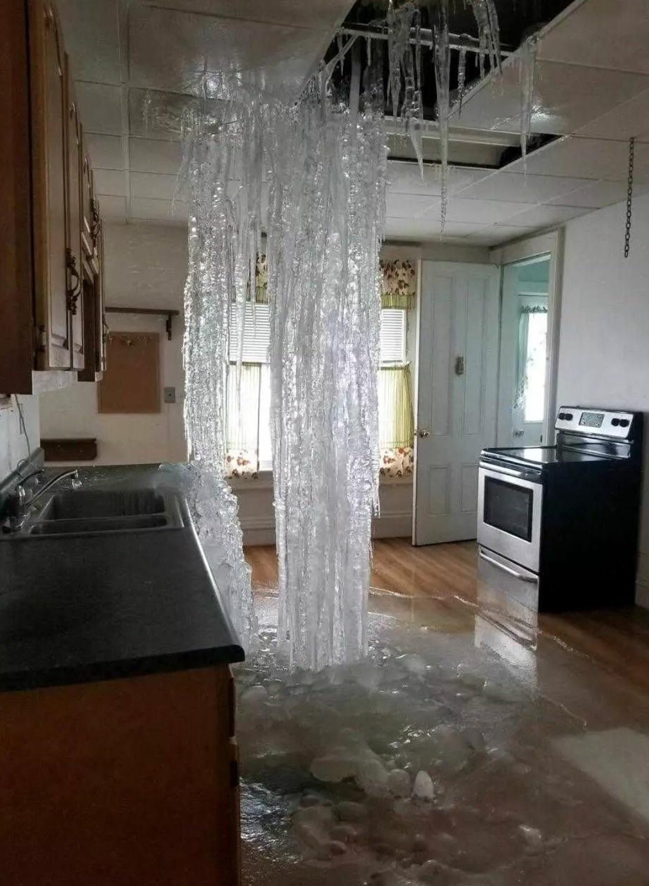

# La dilatazione termica

Bozza v14 — 20 ottobre 2026 (Europe/Rome).
Testo scientifico v7 approvato. Questa v14 conserva il testo approvato e tutte le didascalie. HTML v2 aggiornato al tema comune v21: ripristinate le otto didascalie perse nella conversione precedente e applicati i comandi a icona correnti. Schema del lago con pesci, senza titolo, sottotitolo o testo inferiore.

Didascalia: Il Sydney Harbour Bridge durante una tempesta di polvere rossa.

## Quando cambiano le dimensioni

Un ponte resta nello stesso posto per anni, ma le sue dimensioni non rimangono esattamente uguali. Quando la temperatura sale, l'impalcato tende ad allungarsi; quando scende, tende ad accorciarsi. Anche molti oggetti che usiamo ogni giorno cambiano dimensioni. Perché questo effetto può deformare una struttura e, allo stesso tempo, far funzionare un termostato?

Il fenomeno si chiama **dilatazione termica**. Nei materiali che si comportano nel modo più comune, il riscaldamento aumenta la distanza media fra le particelle: non sono le particelle a diventare più grandi. Nel solido continuano a oscillare attorno alle loro posizioni, ma la loro distanza media può cambiare. Su un corpo esteso, tanti piccoli cambiamenti si sommano e diventano un allungamento o un aumento di volume.

Didascalia: Il giunto permette alle parti della struttura di muoversi entro lo spazio previsto dal progetto.

Per prevedere un allungamento servono tre informazioni: quanto è lungo inizialmente il corpo, di quanto cambia la sua temperatura e di quale materiale è fatto. La **legge della dilatazione lineare** le mette in relazione:[1]

ΔL = α · L_0 · ΔT

Qui L_0 è la lunghezza iniziale e ΔL la sua variazione, entrambe espresse in metri. La differenza ΔT si ottiene sottraendo la temperatura iniziale a quella finale. Il coefficiente α, che si legge «alfa», descrive quanto quel materiale cambia lunghezza per ogni grado di variazione della temperatura; si misura in K⁻¹.

Una struttura inizialmente più lunga presenta un allungamento maggiore, a parità di materiale e variazione di temperatura. Se raddoppia ΔT, raddoppia anche ΔL nel modello. Con α positivo, il raffreddamento dà ΔT negativa e quindi ΔL negativa: il corpo si accorcia. La lunghezza finale si trova aggiungendo ΔL a quella iniziale.

Quanto sono piccoli i coefficienti? La tabella riporta alcuni valori rappresentativi del **coefficiente di dilatazione lineare α**, vicino alla temperatura ambiente.[4] Si confronta la proprietà dei materiali: più grande è α, maggiore è la variazione di lunghezza a parità di lunghezza iniziale e di variazione di temperatura.

**Tabella TAB-01 — Coefficienti di dilatazione lineare di alcuni materiali.**

| Materiale | Coefficiente α (K⁻¹) |
| --- | ---: |
| Alluminio | 2,5 · 10⁻⁵ |
| Ottone | 1,9 · 10⁻⁵ |
| Rame | 1,7 · 10⁻⁵ |
| Acciaio | 1,2 · 10⁻⁵ |
| Vetro comune | 9 · 10⁻⁶ |
| Vetro Pyrex | 3 · 10⁻⁶ |

Questi numeri sono molto piccoli rispetto a 1. Il valore dell'acciaio, per esempio, indica una variazione di appena **dodici milionesimi della lunghezza iniziale per ogni kelvin** di aumento della temperatura. Il coefficiente dell'alluminio è circa doppio di quello dell'acciaio: nelle stesse condizioni, anche l'allungamento è circa doppio. L'effetto resta spesso difficile da vedere su piccoli oggetti, ma può diventare rilevante su grandi lunghezze o quando il movimento è ostacolato.

La variazione può riguardare anche il volume, come accade al liquido di un termometro. La **legge della dilatazione volumica** ha una forma simile:

ΔV = β · V_0 · ΔT

V_0 è il volume iniziale e ΔV la sua variazione, espressi nella stessa unità di volume. Il coefficiente β, «beta», si misura anch'esso in K⁻¹ e riguarda il volume, mentre α riguarda la lunghezza. Una stessa differenza di temperatura ha uguale valore numerico in kelvin e in gradi Celsius: per queste formule conta la variazione, non il valore assoluto della temperatura.

Per i liquidi si usa il coefficiente volumico, perché un liquido prende la forma del recipiente e non conserva una propria lunghezza. La tabella confronta alcuni valori di β **a 20 °C**: un coefficiente maggiore significa una variazione relativa di volume maggiore per lo stesso aumento di temperatura.[4]

**Tabella TAB-02 — Coefficienti di dilatazione volumica di alcuni liquidi a 20 °C.**

| Liquido | Coefficiente β (K⁻¹) |
| --- | ---: |
| Alcol etilico | 1,1 · 10⁻³ |
| Glicerina | 5 · 10⁻⁴ |
| Acqua | 2,1 · 10⁻⁴ |
| Mercurio | 1,8 · 10⁻⁴ |

Il coefficiente dell'alcol etilico è circa cinque volte quello dell'acqua: vicino a 20 °C, a parità di volume iniziale e di piccolo aumento della temperatura, la sua variazione di volume è circa cinque volte maggiore. Il valore dell'acqua riportato qui non descrive il suo comportamento vicino a 4 °C, dove la dilatazione cambia carattere.

## L'acqua cambia comportamento

L'acqua mette in difficoltà l'idea che raffreddare significhi sempre contrarre. A pressione atmosferica, il suo volume è minimo intorno a 4 °C. Raffreddandola da 4 °C verso 0 °C, mentre è ancora liquida, il volume aumenta; scaldandola da 0 °C a 4 °C, diminuisce.

Didascalia: Intorno a 4 °C, 1 kg d'acqua liquida occupa il volume minore. La scala verticale ingrandita rende visibile la piccola variazione.

Il comportamento dipende dai legami fra le molecole, che favoriscono organizzazioni più aperte alle basse temperature. A parità di massa, occupare meno volume significa avere una **densità maggiore**: per questo intorno a 4 °C l'acqua liquida raggiunge la densità massima. Al congelamento avviene un ulteriore aumento di volume, distinto dall'anomalia del liquido. Nel ghiaccio le molecole formano una struttura più aperta e il ghiaccio risulta meno denso dell'acqua liquida.

## Applicazioni

### Quando si scaldano i binari

Didascalia: Il giunto di dilatazione di Hayle permette movimenti longitudinali delle rotaie.

Le rotaie d'acciaio si riscaldano al Sole e tendono ad allungarsi. Nei binari formati da tratti collegati con giunti, gli spazi fra le estremità consentono una parte di questo movimento: quando le rotaie si allungano, gli spazi si riducono. La variazione dipende dalla lunghezza iniziale, dal materiale e dalla variazione di temperatura.

Molte linee usano invece rotaie saldate continue. Qui la dilatazione è in gran parte ostacolata dai fissaggi alle traverse e dalla resistenza della massicciata, lo strato di pietre che sostiene il binario. Il riscaldamento può quindi far aumentare le forze di compressione nelle rotaie. Posa e manutenzione devono tenerne conto: se la compressione supera la capacità del binario di restare stabile, questo può deformarsi lateralmente.

In punti particolari delle linee con rotaie saldate continue si impiegano anche appositi giunti di dilatazione, come quello della fotografia: le parti possono scorrere longitudinalmente per accompagnare i movimenti previsti.

### Trasformare un volume in una temperatura

Didascalia: Il tubicino stretto rende visibile la variazione di volume del liquido.

Nel termometro a liquido il bulbo contiene un liquido che si dilata più del recipiente di vetro. Quando la temperatura aumenta, il volume in eccesso occupa un tratto maggiore del capillare e il livello sale. Il tubicino sottile rende leggibile anche una piccola variazione di volume.

La scala associa le posizioni del livello alle temperature attraverso la taratura. Il dispositivo sfrutta quindi una variazione di dimensioni per misurare una grandezza diversa. Conta il comportamento del liquido rispetto al vetro, che si dilata a sua volta.

### Due metalli possono comandare un interruttore

Didascalia: La diversa dilatazione dei due metalli incurva la lamina.

Didascalia: La diversa dilatazione dei due metalli incurva la lamina e può azionare un contatto.

Una lamina bimetallica è formata da due strati metallici uniti. Quando la temperatura cambia, i due materiali tendono a cambiare lunghezza in misura diversa. Essendo vincolati l'uno all'altro, si incurvano: durante il riscaldamento, lo strato che tende ad allungarsi di più si dispone sul lato esterno della curva.

In un termostato bimetallico questo movimento può separare i contatti e interrompere l'alimentazione di una resistenza. Raffreddandosi, la lamina può riportare il contatto nella posizione iniziale. La dilatazione diventa così un modo per controllare un circuito senza dover leggere continuamente un termometro.

### Un coperchio che si allenta

Didascalia: Coperchio e recipiente possono cambiare dimensioni in misura diversa.

Il riscaldamento di un coperchio metallico può aumentarne il diametro e facilitarne l'apertura. Non basta però dire che «il metallo si dilata»: anche il collo del recipiente può riscaldarsi e cambiare dimensioni. L'effetto utile nasce dalla differenza fra i cambiamenti delle due parti.

Contano i materiali e quanto si riscalda ciascuna parte. Il fenomeno spiega perché il riscaldamento del coperchio possa aiutare, ma non garantisce l'apertura di ogni barattolo.[2]

### Perché il lago gela dall'alto

Didascalia: Il lago Louise, in Canada, con la superficie ghiacciata.

Quando l'acqua superficiale di un lago si raffredda verso 4 °C diventa più densa e tende a scendere, rimescolando l'acqua. Sotto questa temperatura, però, l'ulteriore raffreddamento la rende meno densa: l'acqua più fredda può restare in superficie, dove si forma il ghiaccio.

Didascalia: Sotto il ghiaccio può restare acqua liquida. In questa situazione invernale tipica, la temperatura aumenta verso la zona profonda, dove l'acqua è più densa. Temperature indicative; profondità non in scala.

Il ghiaccio galleggia e lo strato superficiale rallenta la perdita di calore dell'acqua sottostante. In un lago d'acqua dolce sufficientemente profondo può quindi rimanere acqua liquida sotto la superficie gelata.[3] L'anomalia dell'acqua e la minore densità del ghiaccio contribuiscono entrambe a questa situazione.

### Quando il congelamento provoca danni

Didascalia: Ghiaccio accumulato in una cucina di Watertown, nello Stato di New York, dopo una perdita d'acqua durante il gelo del 2018.

Nel lago il ghiaccio può occupare spazio verso la superficie; dentro una tubazione o un recipiente rigido l'acqua può trovarsi invece confinata. Se non può espandersi liberamente, la formazione del ghiaccio può provocare pressioni elevate e danneggiare il contenitore.

La rottura non va attribuita alla sola discesa di temperatura. Conta l'aumento di volume durante il congelamento e conta come l'acqua è confinata. Questo cambiamento accompagna il passaggio da liquido a solido; l'espansione dell'acqua liquida tra 4 °C e 0 °C è un fenomeno distinto.

## Domande di verifica

1. Due parti dello stesso materiale subiscono la stessa variazione di temperatura. Una è lunga il doppio dell'altra. Quale variazione di lunghezza prevede il modello per ciascuna?
2. Vero o falso? «Quando un solido si dilata, le sue particelle diventano più grandi». Motiva.
3. Nei binari con giunti, che cosa accade agli spazi fra le rotaie quando queste si riscaldano? Perché anche le rotaie saldate continue richiedono di considerare la temperatura?
4. Nel termometro a liquido, quale cambiamento rende visibile il capillare? Perché bisogna considerare anche il vetro?
5. Una lamina è formata da due metalli con uguale dilatazione nelle condizioni considerate. Ti aspetti lo stesso incurvamento termico di una lamina con materiali diversi? Spiega.
6. Perché riscaldare un coperchio può facilitarne l'apertura, ma non garantisce sempre il risultato?
7. Scaldando una stessa massa d'acqua liquida da 0 °C a 4 °C, il suo volume: A) aumenta; B) diminuisce; C) resta invariato. Motiva la scelta.
8. Perché volume minimo e densità massima corrispondono alla stessa temperatura, se la massa resta uguale?
9. Quale ruolo hanno l'anomalia dell'acqua e il galleggiamento del ghiaccio nella formazione del ghiaccio superficiale di un lago?
10. Vero o falso? «L'aumento di volume dell'acqua liquida sotto 4 °C e l'aumento di volume durante il congelamento sono lo stesso fenomeno». Spiega.
11. Perché, per comprendere una rottura da gelo, non basta sapere che l'acqua è congelata, ma occorre considerare anche il recipiente?

12. Confronta alcol etilico e acqua nella tabella TAB-02: vicino a 20 °C, quale presenta la maggiore variazione di volume a parità di volume iniziale e piccolo aumento di temperatura? Perché il valore dell'acqua non si può usare allo stesso modo vicino a 4 °C?

## Note

[1] Le due leggi sono approssimazioni utili quando il coefficiente del materiale varia poco nell'intervallo considerato e il corpo può dilatarsi liberamente. Un coefficiente positivo costante non descrive l'acqua attraverso il minimo di volume.

[2] Il caso serve a interpretare un fenomeno, non a proporre di scaldare recipienti chiusi o usare acqua bollente.

[3] La situazione dipende anche dalla profondità, dal clima e dal rimescolamento: non tutti i laghi mantengono sempre acqua a 4 °C sul fondo e quelli poco profondi possono gelare completamente.

[4] I coefficienti riportati sono valori rappresentativi a 20 °C; possono variare con la composizione del materiale e con la temperatura. I valori dei liquidi descrivono variazioni a pressione pressoché costante.

## Crediti di servizio — non sezione didattica

Testo originale. Fonti consultate per controllo dei principi; trasferire i riferimenti al registro unico nella fase HTML:
- OpenStax, College Physics 2e, §13.2, Thermal Expansion of Solids and Liquids: https://openstax.org/books/college-physics-2e/pages/13-2-thermal-expansion-of-solids-and-liquids . Riferimento per leggi e principi di dilatazione. TAB-01 riporta i coefficienti lineari di alluminio, ottone, rame, acciaio, vetro comune e vetro Pyrex della tabella 13.2, riferiti a 20 °C e espressi in notazione scientifica normalizzata. Nessuna colonna di allungamenti calcolati. TAB-02 riporta dalla stessa tabella i coefficienti volumici a 20 °C di alcol etilico, glicerina, acqua e mercurio, in notazione scientifica normalizzata. Nessuna immagine ripresa.
- U.S. Geological Survey, Water Science School, Water Density: https://www.usgs.gov/water-science-school/science/water-density . Controllo di densità massima intorno a 4 °C, minore densità del ghiaccio e conseguenze nei laghi. Nessuna tabella numerica o immagine ripresa.

- Network Rail, Buckled rail: https://www.networkrail.co.uk/rail-travel/delays-explained/buckled-rail-and-summer-heat/ . Controllo delle conseguenze del riscaldamento e della gestione delle rotaie saldate continue; nessuna immagine ripresa.

Le fotografie scelte sono state recuperate e sono documentate in risorse/originali.json e visuali.md. La dichiarazione di autorizzazione dell’utente per FIG-06 non viene convertita in licenza libera. L’HTML incorpora le figure e il font del tema comune v19.

GRA-01: NIST, Selected Procedures for Volumetric Calibrations (2019), GLP 10 §6.1, https://doi.org/10.6028/NIST.IR.7383-2019 . Relazione di Tanaka et al. (2001), acqua pura priva di aria disciolta a 101325 Pa. Conversione del volume di 1 kg dalla densità; dati di riferimento calcolati, non nuove misure.

FIG-05b: schema generato con OpenAI imagegen su richiesta dell’utente; revisione del 20 ottobre 2026 senza titolo, sottotitolo e scritta inferiore, con quattro pesci d’acqua dolce. Il riferimento stock resta materiale di sola lavorazione.

FIG-06: post r/WTF di u/mynameisadrean, https://www.reddit.com/r/WTF/comments/7p2hss/this_is_what_happens_in_my_hometown_when_you_dont/ . Big Frog 104, 12 gennaio 2018, https://bigfrog104.com/watertown-frozen-waterfall-inside/ , accredita la foto a Bennett Realty; titolarità non accertata autonomamente. Autorizzazione all’uso dichiarata dall’utente in chat.
