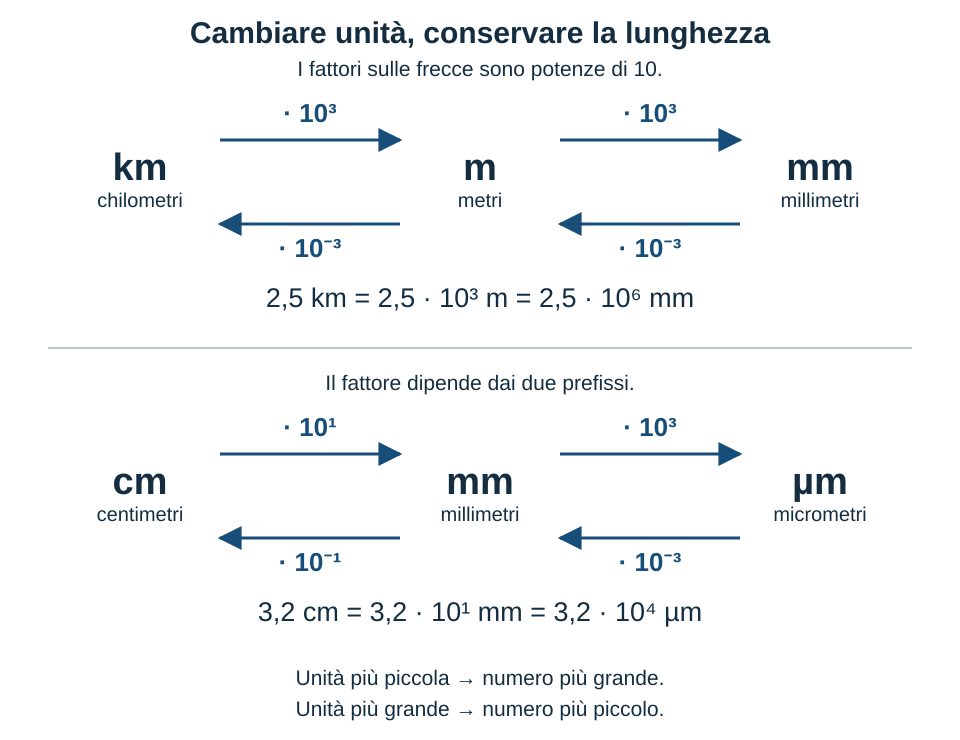

# I prefissi del Sistema internazionale

<!-- Bozza v1 — 23 ottobre 2026 (Europe/Rome).
Area: Introduzione alla fisica e alla misura.
Riuso della tabella richiesto dall'utente; realizzazione dello schema SCH-01 autorizzata con «Ok fai lo schema».
Testo da approvare. Segnaposto e servizio editoriale non fanno parte del contenuto pubblicabile. -->

[COP-01 — Riuso della fotografia del metro già scelta nel capitolo 2: ../grandezze_fisiche_sistema_internazionale/risorse/metro.jpg. Immagine intera, non ripetuta nel corpo.]

Didascalia: Un metro a nastro permette di confrontare una lunghezza con le suddivisioni dell'unità.

## La lunghezza resta, il numero cambia

Su un metro a nastro leggiamo centimetri e millimetri. Ogni centimetro contiene dieci millimetri: lo spazio fra due tacche dei centimetri viene diviso in dieci parti. La stessa lunghezza può quindi essere scritta come 1 m, 100 cm oppure 1000 mm. Perché cambia il numero, mentre la lunghezza rimane la stessa?

Il numero indica quante volte l'unità scelta è contenuta nella lunghezza. Se scegliamo un'unità cento volte più piccola, ne occorrono cento volte di più. Il cambiamento riguarda la coppia formata da numero e unità: aumentare il numero senza cambiare l'unità indicherebbe una lunghezza diversa.

Le parole **centimetro** e **millimetro** contengono già l'informazione necessaria. Il **prefisso** centi significa un centesimo, mentre milli significa un millesimo. Aggiungendo il prefisso al nome dell'unità otteniamo un suo multiplo o sottomultiplo decimale.

[TAB-02 — Prospetto delle scritture equivalenti.]

| Scrittura | Stessa lunghezza espressa in metri |
| --- | --- |
| 1 km | 1000 m |
| 1 m | 1 m |
| 1 cm | 0,01 m |
| 1 mm | 0,001 m |
| 1 µm | 0,000001 m |

Didascalia: Il prefisso indica un fattore esatto rispetto al metro. Cambiano le dimensioni dell'unità scelta, non la lunghezza rappresentata dall'equivalenza.

## Un prefisso è una potenza di dieci

Il prefisso kilo, simbolo **k**, rappresenta il fattore 1000, cioè 10³. Per questo 1 km = 10³ m. Il prefisso micro, simbolo **µ**, rappresenta invece 10⁻⁶: un micrometro è un milionesimo di metro. Le potenze di dieci ci permettono di leggere allo stesso modo prefissi molto grandi e molto piccoli.

La tabella raccoglie i prefissi del Sistema internazionale. Per ciascuno riporta il nome, il simbolo e il fattore che moltiplica l'unità. Per leggerla non occorre considerare ogni riga un «gradino»: gli esponenti non cambiano sempre della stessa quantità.

[TAB-01 — Riutilizzare la tabella completa del sorgente, mantenendo i 24 prefissi e la disposizione con multipli e sottomultipli affiancati.]

| Multiplo | Simbolo | Fattore | Sottomultiplo | Simbolo | Fattore |
| --- | --- | --- | --- | --- | --- |
| quetta | Q | 10³⁰ | quecto | q | 10⁻³⁰ |
| ronna | R | 10²⁷ | ronto | r | 10⁻²⁷ |
| yotta | Y | 10²⁴ | yocto | y | 10⁻²⁴ |
| zetta | Z | 10²¹ | zepto | z | 10⁻²¹ |
| exa | E | 10¹⁸ | atto | a | 10⁻¹⁸ |
| peta | P | 10¹⁵ | femto | f | 10⁻¹⁵ |
| tera | T | 10¹² | pico | p | 10⁻¹² |
| giga | G | 10⁹ | nano | n | 10⁻⁹ |
| mega | M | 10⁶ | micro | µ | 10⁻⁶ |
| kilo | k | 10³ | milli | m | 10⁻³ |
| etto (hecto) | h | 10² | centi | c | 10⁻² |
| deca | da | 10¹ | deci | d | 10⁻¹ |

Didascalia: I prefissi esprimono multipli e sottomultipli decimali. Quetta, ronna, ronto e quecto estendono l'intervallo fino ai fattori 10³⁰ e 10⁻³⁰.

Le maiuscole fanno parte del simbolo. **M** indica mega e **m** indica milli: 1 Mm vale 1 000 000 m, mentre 1 mm vale 0,001 m. Fra queste due lunghezze c'è un fattore di un miliardo. Nell'ultima m di entrambe le scritture riconosciamo il metro; la lettera che la precede è il prefisso.

Il simbolo del prefisso resta unito a quello dell'unità, mentre uno spazio separa il numero dal simbolo completo: scriviamo **5 km**, non 5 k m. Per il chilometro la k è minuscola. Queste convenzioni permettono di comunicare il valore senza dover indovinare il significato delle lettere.

## Passare da un prefisso all'altro

Per convertire una lunghezza possiamo sostituire il prefisso con il suo fattore. In 2,5 km ogni chilometro contiene 1000 metri: il numero va moltiplicato per 1000.

\[
2{,}5\ \mathrm{km} = 2{,}5 \cdot 1000\ \mathrm{m} = 2500\ \mathrm{m}
\]

Se vogliamo arrivare ai millimetri, ogni metro contiene a sua volta 1000 millimetri. Il secondo passaggio moltiplica ancora il numero per 1000. Nel complesso il numero iniziale viene moltiplicato per un milione:

\[
2{,}5\ \mathrm{km} = 2500\ \mathrm{m} = 2\,500\,000\ \mathrm{mm}
\]

[SCH-01 — Schema delle conversioni realizzato su richiesta: risorse/schema-conversioni.svg. Incorporare senza cambiare composizione; rendere disponibile l'ingrandimento del tema.]

Didascalia: Segui il verso della freccia e applica al numero il fattore indicato. Tornando indietro si usa il fattore reciproco: i due percorsi conservano la stessa lunghezza.

Lo schema mostra anche perché non basta contare i passaggi. Fra centimetro e millimetro il fattore è 10; fra millimetro e micrometro è 1000. Così 3,2 cm diventano 32 mm e poi 32 000 µm. Sono tre modi di descrivere la stessa lunghezza: i millimetri sono dieci volte più piccoli dei centimetri e i micrometri mille volte più piccoli dei millimetri.

Nel verso inverso il numero diminuisce. Per passare da 32 mm a centimetri lo moltiplichiamo per 0,1 e otteniamo 3,2 cm. Per passare da 750 µm a millimetri, invece, il fattore è 0,001:

\[
750\ \mathrm{\mu m} = 750 \cdot 0{,}001\ \mathrm{mm} = 0{,}750\ \mathrm{mm}
\]

Il risultato è plausibile: 1000 µm formano 1 mm e 750 µm ne rappresentano tre quarti. Facendo il percorso inverso, 0,750 · 1000 restituisce 750. Controllare il verso del cambiamento e rifare la conversione al contrario aiuta a riconoscere un fattore sbagliato.

La tabella permette anche di trovare il fattore direttamente. Il prefisso centi ha esponente −2 e milli ha esponente −3. Il rapporto fra i loro fattori è:

\[
\frac{10^{-2}}{10^{-3}} = 10^{-2-(-3)} = 10^1 = 10
\]

Questo è il fattore che trasforma il numero espresso in centimetri nel numero espresso in millimetri. **Si sottrae l'esponente del prefisso di arrivo da quello del prefisso di partenza.** Da micro a milli otteniamo −6 − (−3) = −3: il fattore è 10⁻³, cioè 0,001. È lo stesso risultato trovato passando per il metro.

I prefissi permettono infine di sostituire lunghe file di zeri con numeri leggibili. La lunghezza 0,000047 m, scritta come 47 · 10⁻⁶ m, diventa **47 µm**. Allo stesso modo, 0,8 µm equivale a 0,8 · 10⁻⁶ m, cioè 0,0000008 m: la scrittura con micro mantiene visibili le cifre del numero senza dover contare gli zeri.

## Il grammo, le aree e i volumi

Per la massa incontriamo una particolarità: l'unità di base è il **chilogrammo**, il cui nome contiene già un prefisso. Per costruire gli altri multipli e sottomultipli si applica il prefisso al **grammo**. Un milligrammo è quindi un millesimo di grammo, non un millesimo di chilogrammo.

[TAB-03A — Equivalenze della massa.]

| Stessa massa | In grammi | In chilogrammi |
| --- | --- | --- |
| 1 kg | 1000 g | 1 kg |
| 1 g | 1 g | 0,001 kg |
| 1 mg | 0,001 g | 0,000001 kg |

Didascalia: Per passare da milligrammi a chilogrammi intervengono due fattori 1000. Il prefisso milli si riferisce al grammo.

Un'altra attenzione serve quando l'unità è elevata a potenza. Un centimetro quadrato è l'area di un quadrato con lato di un centimetro. Siccome ogni lato vale 0,01 m, nel prodotto delle due lunghezze il fattore 0,01 compare due volte:

\[
1\ \mathrm{cm}^2 = (0{,}01\ \mathrm{m})^2 = 0{,}0001\ \mathrm{m}^2
\]

Per il centimetro cubo lo stesso fattore compare tre volte. L'esponente riguarda l'intera unità prefissata: non possiamo convertire aree e volumi usando soltanto il fattore della lunghezza.

[TAB-03B — Fattori per lunghezza, area e volume.]

| Grandezza | Conversione | Fattore numerico |
| --- | --- | --- |
| Lunghezza | 1 cm = 0,01 m | 0,01 |
| Area | 1 cm² = 0,0001 m² | (0,01)² = 0,0001 |
| Volume | 1 cm³ = 0,000001 m³ | (0,01)³ = 0,000001 |

Didascalia: Il fattore lineare viene elevato alla seconda potenza per le aree e alla terza per i volumi.

## Domande di verifica

1. Spiega perché 1 m, 100 cm e 1000 mm rappresentano la stessa lunghezza. Che cosa cambia scegliendo un'unità più piccola?
2. Vero o falso? «1 Mm e 1 mm indicano la stessa lunghezza.» Spiega usando le potenze di dieci.
3. Quale prefisso permette di scrivere 47 · 10⁻⁶ m senza la potenza di dieci esplicita? Indica la nuova scrittura e giustificala con la tabella.
4. Converti 3,2 cm in millimetri e 750 µm in millimetri. Prima di calcolare, spiega se il numero dovrà aumentare o diminuire. Verifica uno dei risultati con la conversione inversa.
5. Quale equivalenza è corretta: 0,8 µm = 0,8 · 10⁶ m, 0,8 µm = 0,8 · 10⁻⁶ m oppure 0,8 µm = 0,8 · 10⁻³ m? Motiva la scelta.
6. Correggi la scrittura «5 k m». Perché «5 km» e «5 Km» non sono scritture intercambiabili del chilometro?
7. Un compagno scrive «1 mg = 0,001 kg». Ha applicato milli all'unità corretta? Correggi l'equivalenza passando prima per il grammo.
8. Vero o falso? «1 cm² = 0,01 m².» Motiva la risposta considerando i due lati del quadrato.

---

## Servizio editoriale — fonti e provenienza

Questa sezione non entra nel testo pubblico. Durante la realizzazione le fonti confluiranno nel registro unico e nei crediti incorporati.

- Sorgente: sistema_internazionale_notazione_it.html, sezione #prefissi, blob 61a32e96afce2136af8669b1544a02e9d751018d. Tabella conservata nei 24 nomi, simboli e fattori, compresa la forma italiana «etto (hecto)» del sorgente. Nessun intervento sull'HTML storico.
- Controllo normativo della tabella: [BIPM, SI prefixes](https://www.bipm.org/en/measurement-units/si-prefixes), consultato il 23 ottobre 2026. Verificati simboli ed esponenti da quetta a quecto e riferimento alla risoluzione CGPM 3 del 2022. Per la realizzazione verificare anche le regole tipografiche e il caso del grammo nella [SI Brochure](https://www.bipm.org/en/publications/si-brochure).
- COP-01: foto già scelta e verificata nel capitolo 2, Nenad Stojkovic, CC BY 2.0, [pagina dell'originale](https://commons.wikimedia.org/wiki/File:A_pair_of_hands_holding_a_construction_measuring_tape.jpg). Riusare la scheda esistente del registro, associandola al nuovo capitolo. Nessuna misura numerica ricavata dalla foto.
- SCH-01: schema SVG originale costruito tramite codice dopo la richiesta «Ok fai lo schema». Mostra relazioni numeriche esatte, senza dati sperimentali o immagini di oggetti. Non è la ricostruzione della vecchia scala illustrata, conservata nel sorgente.
- I prospetti numerici illustrano equivalenze, senza costituire nuovi esercizi applicativi o nuove situazioni fisiche. TAB-03A e TAB-03B sono le due parti del prospetto TAB-03 proposto.
- Quesiti: conservato l'originale 6 nel n. 2; completata soltanto la parte sui prefissi dell'originale 5 nel n. 3. La trasformazione scientifica/ingegneristica resta nel capitolo 3 e l'originale 12 sulle cifre significative resta assegnato al capitolo 5. Otto domande complessive, senza soluzioni.
- Nessun riepilogo aggiuntivo, video, simulazione o nuova fotografia. Nessuna realizzazione HTML del capitolo, modifica del manifest o pubblicazione in questa fase.
